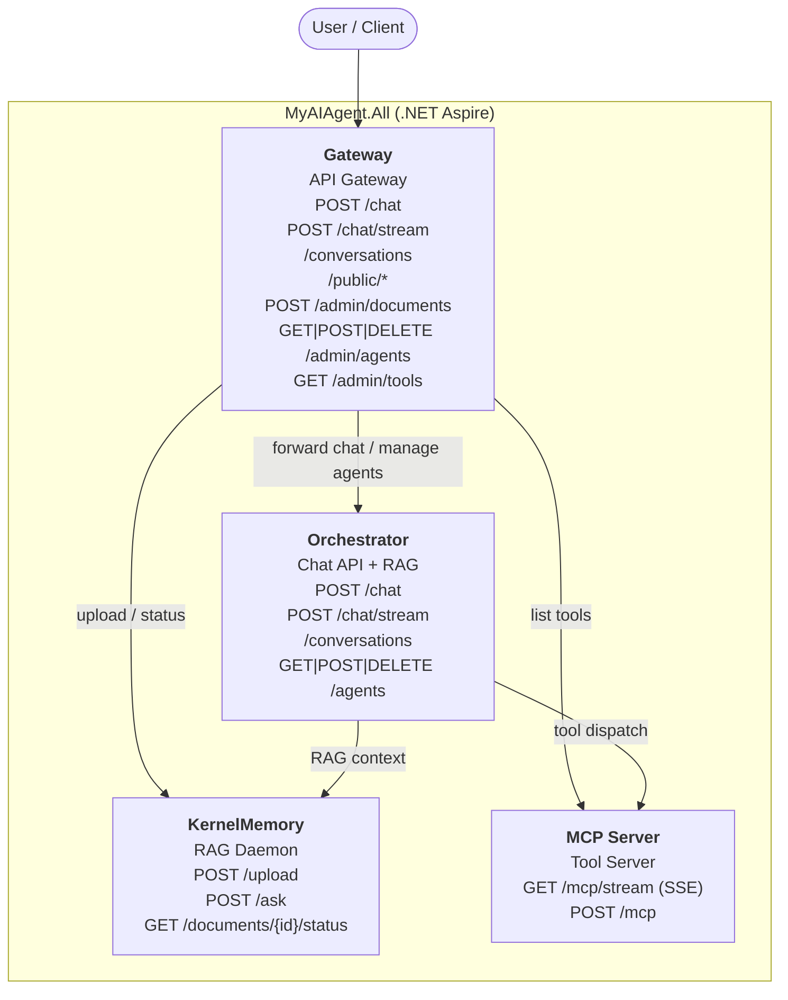
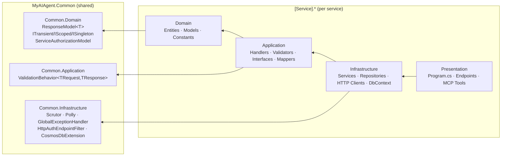

# MyAIAgent

A modular AI agent backend built on **.NET 10** with Clean Architecture. Four independently deployable services orchestrated by .NET Aspire.

## AI development workflow

Use Plan (Opus/Astra) → Build with tests (Sonnet/Sol) → parallel code/security
Verify (Sonnet/Sol) → Commit, with an optional draft PR. Start with the
[setup guide](.agents/docs/setup.md); shared policy lives in [AGENTS.md](AGENTS.md) and
[the workflow](.agents/docs/workflow.md).

| Stage | Claude Code (terminal / IDE) | Codex (terminal / app / IDE) |
| --- | --- | --- |
| Plan | `/ai-plan <task>` → native Plan mode, Opus via `opusplan` | Select Astra, enable native Plan mode, invoke `$ai-plan <task>` |
| Build | Accept/exit native Plan mode, then `/ai-build` → Sonnet | Exit Plan mode, select Sol, invoke `$ai-build` |
| Verify | `/ai-verify` → two Sonnet reviewers | `$ai-verify` → two Sol reviewers |
| Commit | `/ai-commit` → Sonnet | `$ai-commit` with Sol selected |

These are skill commands in the conversation composer, not shell commands.
The `ai-` prefix keeps native `/plan` and bundled review commands available.
In Codex use `/skills` or the app's skill picker; repository Markdown cannot
register arbitrary native slash commands or automatically change Astra/Sol.
Claude can enter Plan mode through `EnterPlanMode`; if the host lacks that tool,
use its Plan mode control first. See [setup](.agents/docs/setup.md) for discovery,
model confirmation, and surface-specific controls.
At the Commit stage, the assistant asks one question with the three delivery
choices defined in [the workflow](.agents/docs/workflow.md) before staging or
committing.

```bash
node scripts/ai/quality.mjs
```

Azure Container Apps deployment and rollback setup is documented in
[the deployment guide](docs/deployment.md).

## Service Topology



> **Note:** MCP Server never connects to KernelMemory. RAG is the Orchestrator's responsibility.

## Clean Architecture Layers



## Services

| Service | Aspire Name | Entry Points | Purpose |
|---|---|---|---|
| **Gateway** | `gateway` | `POST /chat`, `POST /chat/stream`, `/conversations`, `/public/*`, `/admin/documents`, `/admin/agents`, `/admin/tools` | API gateway — routes to all backend services; [public streaming chat](docs/public-chat-api.md) for browser widgets |
| **Orchestrator** | `orchestrator` | `POST /chat`, `POST /chat/stream`, `/conversations`, `GET\|POST\|DELETE /agents` | Chat API — Microsoft Agents Framework + RAG context |
| **KernelMemory** | `kernel-memory` | `POST /upload`, `POST /ask`, `GET /documents/{id}/status` | RAG daemon — embedding, vector store, semantic Q&A |
| **MCP Server** | `mcp-server` | `GET /mcp/stream`, `POST /mcp` | Tool server — exposes tools to LLMs via Model Context Protocol |

## Tech Stack

| Area | Technology |
|---|---|
| Runtime | .NET 10 / C# 14 |
| Orchestration | .NET Aspire |
| AI Agent Framework | Microsoft Agents (`Microsoft.Agents.AI` v1.0.0-rc1) |
| AI Abstractions | `Microsoft.Extensions.AI` + `Microsoft.Extensions.AI.OpenAI` |
| RAG / Knowledge | Microsoft KernelMemory (self-hosted, Azure AI Search vector store) |
| MCP Protocol | ModelContextProtocol SDK v0.5.0-preview.1 |
| CQRS | MediatR v12.5.0 |
| Validation | FluentValidation v11.11.0 |
| HTTP Resilience | Polly via `Microsoft.Extensions.Http.Resilience` |
| DI Convention | Scrutor v7.0.0 |
| Database | Azure Cosmos DB for NoSQL: `myaiagent-test` (dev, tests, staging) and `myaiagent-prod` |
| Testing | xUnit + Moq + FluentAssertions |

## Solution Structure

```
src/
  MyAIAgent.slnx
  MyAIAgent.All/                          # .NET Aspire — starts all four services
  MyAIAgent.Common.Domain/                # ResponseModel<T>, DI markers, ServiceAuthorizationModel
  MyAIAgent.Common.Application/           # ValidationBehavior
  MyAIAgent.Common.Infrastructure/        # Scrutor, Polly, HttpAuthEndpointFilter, CosmosDbExtension
  MyAIAgent.McpServer.*/                  # MCP tool server (web_search, get_current_datetime)
  MyAIAgent.Orchestrator.*/               # Chat API + session persistence + agent management
  MyAIAgent.KernelMemory.*/               # Self-hosted KernelMemory RAG daemon
  MyAIAgent.Gateway.*/                 # API gateway (document mgmt, agent mgmt, chat forwarding)
```

## Getting Started

### Prerequisites

- .NET 10 SDK
- Azure OpenAI (or OpenAI) API credentials
- An Azure Cosmos DB account with the `myaiagent-test` database and an Azure AI Search service. Create them once with
  `infra/cosmos.bicep` and `infra/search.bicep` (both use the free tier; see [docs/deployment.md](docs/deployment.md))

### Run via Aspire (recommended)

```bash
dotnet restore
dotnet run --project src/MyAIAgent.All
```

Aspire starts all four services and opens the dashboard with live endpoint URLs. There is no local database: in
Development the Orchestrator and KernelMemory use the **test** Cosmos database (`myaiagent-test`), create its containers
on startup, and refuse to start against any database other than `myaiagent-test`.

### Configure secrets

```bash
# Orchestrator — AI provider and test database
cd src/MyAIAgent.Orchestrator.Presentation
dotnet user-secrets set "ConnectionStrings:CosmosDb" "<test account connection string>"
dotnet user-secrets set "AzureOpenAI:Endpoint" "https://<resource>.openai.azure.com/"
dotnet user-secrets set "AzureOpenAI:DeploymentName" "gpt-4o"
dotnet user-secrets set "AzureOpenAI:ApiKey" "<key>"

# KernelMemory — test database, embeddings and vector store
cd src/MyAIAgent.KernelMemory.Presentation
dotnet user-secrets set "ConnectionStrings:CosmosDb" "<test account connection string>"
dotnet user-secrets set "KernelMemory:Services:AzureOpenAIEmbedding:APIKey" "<key>"
dotnet user-secrets set "KernelMemory:Services:AzureOpenAIText:APIKey" "<key>"
dotnet user-secrets set "KernelMemory:Services:AzureAISearch:Endpoint" "https://<name>.search.windows.net"
dotnet user-secrets set "KernelMemory:Services:AzureAISearch:APIKey" "<admin key>"
```

### Build and test

```bash
dotnet build src/MyAIAgent.slnx
dotnet test src/MyAIAgent.slnx
dotnet format src/MyAIAgent.slnx --verify-no-changes
```

## Contributing

- Follow [AGENTS.md](AGENTS.md) and the [project conventions](.agents/docs/project.md).
- Follow the shared [Plan → Build → Verify → Commit workflow](.agents/docs/workflow.md).
- Run `node scripts/ai/quality.mjs` and both parallel reviewers before commit/PR.
- Use conventional commit prefixes: `feat:`, `fix:`, `refactor:`, `test:`, `docs:`, `chore:`
