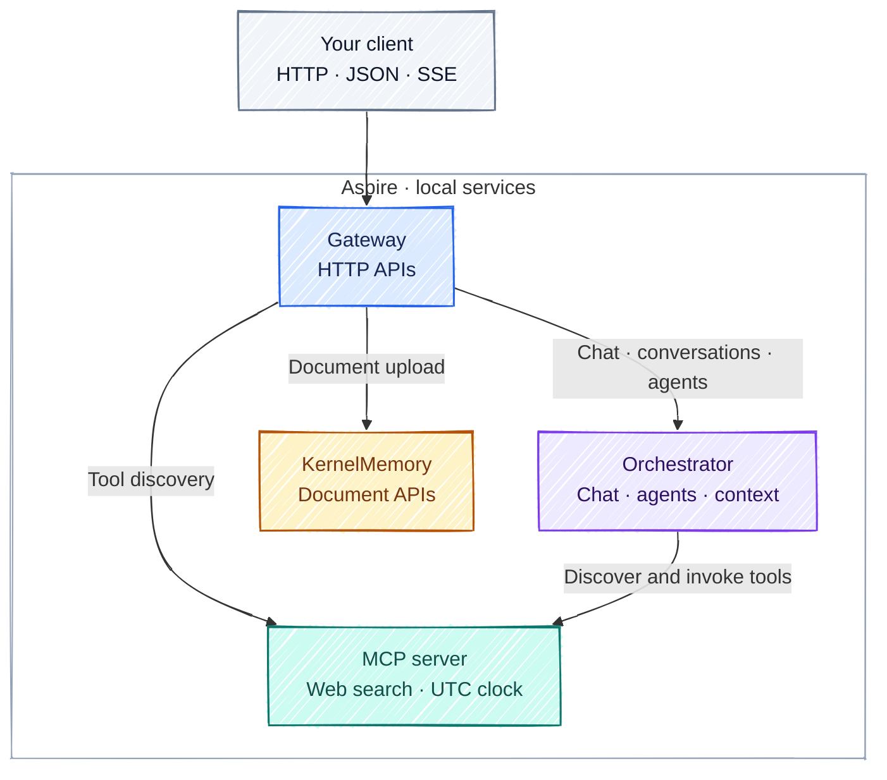
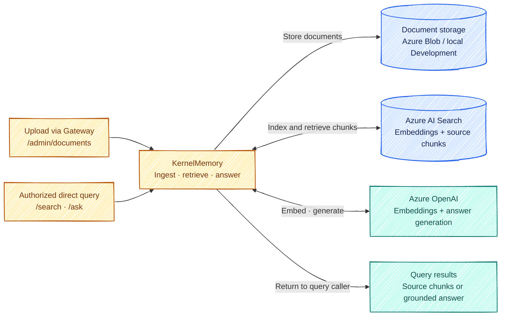

<div align="center">

# MyAIAgent

**Conversational AI, MCP tools, and document knowledge — built in C#.**

A backend application foundation and learning repository, with explicit service boundaries, persistent conversations, and local orchestration through Aspire.

[](src/MyAIAgent.slnx)
[](src/)
[](src/MyAIAgent.All/)
[](scripts/)

[Quick start](#quick-start) · [Architecture](#architecture-at-a-glance) · [Engineering decisions](#engineering-decisions) · [Documentation](#documentation)

</div>

## What you can build with it

| Capability | What is implemented |
| --- | --- |
| **Chat that streams** | JSON replies and Server-Sent Events, with session, text, title, completion, and error events. |
| **Conversations that persist** | Cosmos DB history, owner-scoped list/get/rename/delete operations, and optimistic concurrency. |
| **Agents with tools** | Configurable instructions, MCP endpoints, and tool selection through `Microsoft.Extensions.AI.IChatClient`. |
| **A small MCP server** | `web_search` and `get_current_datetime` over Streamable HTTP. |
| **Document knowledge** | A separate KernelMemory service for ingestion, embeddings, search, and question answering. Gateway forwards document uploads. |
| **Browser integration** | An optional public API with visitor JWT validation, origin checks, rate limits, streaming, and conversation routes. |
| **Local and Azure delivery** | Four services launched by Aspire; Bicep and GitHub Actions for Azure Container Apps delivery. |

> **Backend repository:** there is no frontend application here. Use the HTTP APIs, Gateway's Scalar API reference, or your own client.

## Architecture at a glance

Gateway is the client entry point. Orchestrator owns conversation processing; MCP supplies tools; KernelMemory runs the document workflow independently.



Orchestrator uses Azure OpenAI or OpenAI and stores sessions, messages, and agents in Cosmos DB. The MCP web-search tool uses Google Custom Search and fetches public pages.

The diagram shows the first-party MCP server. Agents can also use explicitly approved external HTTPS MCP origins through a separate anonymous client. Service keys stay scoped to the configured first-party origin and protocol routes.

Aspire starts the processes and exposes their endpoints. The current HTTP clients read configured base URLs; project references alone do not enable client-side service discovery.

### What happens during a chat turn?

1. **Identify and validate.** Gateway resolves the caller and forwards the request to Orchestrator with its service key.
2. **Prepare context.** Orchestrator loads the caller-owned session and selected agent, builds conversation history, and discovers permitted MCP tools.
3. **Generate and use tools.** The model can request tools through the retained MCP client. Streaming text is forwarded as it arrives.
4. **Commit the turn.** The completed turn is saved before optional title and summary updates. A truncated downstream stream becomes an error rather than an apparent success.

Read the [request-flow diagrams](docs/architecture.md#a-chat-turn) for persistence ordering, cancellation, and streaming details.

### A separate path for documents



> **Current integration boundary:** Orchestrator does not retrieve document context from KernelMemory during chat. The document APIs form a standalone RAG capability; automatic document-grounded chat is future work. Query embeddings also use Azure OpenAI.

See [document ingestion and RAG](docs/architecture.md#document-ingestion-and-rag) for routes, provider requirements, and the parts of the document model that are not yet wired into uploads.

## Quick start

### 1. Build and verify

Install **.NET 10 SDK** and **Node.js 20.6+**, then run from the repository root:

```bash
npm ci --ignore-scripts
npm run quality
```

The default quality gate does not require Azure credentials. Cosmos integration tests are explicitly **skipped** unless `COSMOS_TEST_ENDPOINT` is configured.

### 2. Configure the services

Follow the [local setup guide](docs/local-development.md) to provision development dependencies, sign in with Azure CLI, configure each service's user-secrets, and trust the HTTPS development certificate. Azure App Configuration is optional locally.

MCP authorization is enabled by default. Configure its active and rotation keys, with the matching active key in Gateway and Orchestrator. Keep filled-in configuration outside Git.

### 3. Run with Aspire

```bash
dotnet run --project src/MyAIAgent.All --launch-profile https
```

Open the dashboard URL printed by AppHost. Gateway's default API reference is **[https://localhost:7200/scalar/](https://localhost:7200/scalar/)**. Use the dashboard's displayed endpoints if your local configuration differs.

Start with `/health/live` on each service, then Gateway's `/admin/agents` and `/admin/tools` to verify connectivity without a model call. These local Development routes must remain private. Chat and document operations can consume paid provider usage.

## Engineering decisions

| Decision | Why it is here |
| --- | --- |
| **Clean Architecture** | Application handlers depend on ports; Infrastructure owns HTTP, model providers, and persistence. Services communicate over HTTP. |
| **CQRS with MediatR** | Commands, queries, validators, and mappings make request handling explicit. Streaming has its own validation pipeline. |
| **Persistence before optional metadata** | A failed title or summary update does not invalidate a committed turn. Cosmos ETags prevent stale session overwrites. |
| **Bounded conversation context** | Older turns can be summarized while persisted messages remain available. Summaries are replayed as user context, not system instructions. |
| **Separate configuration responsibilities** | User-secrets hold local credentials; AAC holds nonsecret settings; deployed services use Azure identities and scoped Key Vault references. |
| **Enforced outbound boundaries** | MCP origins are approved explicitly. DNS answers are checked at connection time; external clients cannot acquire the first-party service key. |
| **Repeatable verification** | One command checks TypeScript, automation, solution builds, service tests, and changed C# formatting. Skipped live tests remain visible. |

The separate services and layers add setup and project structure. They make responsibilities easier to inspect and test; deployment scale and production readiness require further operational evidence.

## Documentation

| Start with… | When you want to… |
| --- | --- |
| [Local development](docs/local-development.md) | Configure dependencies, secrets, Aspire profiles, and HTTPS. |
| [Architecture and request flows](docs/architecture.md) | Follow chat, streaming, tools, persistence, and document ingestion. |
| [Repository guide](docs/repository-guide.md) | Navigate the solution and understand file responsibilities. |
| [Public streaming chat API](docs/public-chat-api.md) | Connect a browser client and handle visitor identity and SSE. |
| [Configuration security](docs/security.md) | Understand authorization, credentials, outbound policy, and rotation. |
| [Deployment](docs/deployment.md) | Work with Bicep, Container Apps, and environment promotion. |
| [Dependencies](docs/dependencies.md) | Review provider constraints, package versions, and license considerations. |
| [Contributing](CONTRIBUTING.md) | Extend a service, maintain documentation, and run checks. |

## Current limitations

- **Client integration:** no frontend or public visitor-token issuer is included.
- **Provider requirements:** the wired KernelMemory providers require Azure OpenAI and Azure AI Search, even when Orchestrator uses OpenAI.
- **Authorization:** service keys do not identify individual callers or provide tool-specific permissions. Approved MCP tool descriptions and results remain untrusted.
- **Operations:** health endpoints establish process availability. Search and Blob still use provider keys, and public API rate limits are process-local.
- **Deployment evidence:** CI/CD definitions and local test results do not establish that production deployment or multi-replica behavior has been exercised. Azure usage can incur charges.
