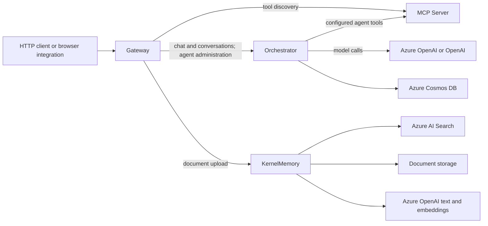

# MyAIAgent

A .NET backend for conversational AI, persistent chat history, MCP tools, and a separate document knowledge service. This repository is both an application foundation and a learning project: it shows how API boundaries, application handlers, external providers, and deployment tooling fit together.

Built with **C# / .NET 10**, **TypeScript automation**, and **.NET Aspire**. There is no frontend application in this repository; clients use the HTTP APIs.

## What works today

| Capability | Implementation |
| --- | --- |
| Chat and streaming | Gateway forwards ordinary chat and Server-Sent Events to Orchestrator. Streams include session, text, title, completion, and error events. |
| Conversations | Cosmos DB stores sessions and messages, with owner-scoped list/get/rename/delete operations and optimistic concurrency. |
| Configurable agents | Agent definitions supply instructions, an MCP server endpoint, and tool selection. Model calls use `Microsoft.Extensions.AI.IChatClient`. |
| MCP tools | The MCP server exposes `web_search` and `get_current_datetime` over Streamable HTTP. |
| Document knowledge | Self-hosted KernelMemory accepts uploads, builds embeddings in Azure AI Search, and exposes search and question-answering APIs. Gateway exposes document upload. |
| Browser chat API | Optional visitor JWT authentication, origin checks, rate limits, streaming, and conversation routes. See the [public API guide](docs/public-chat-api.md). |
| Local and Azure delivery | Aspire launches the four services locally. Bicep and GitHub Actions describe Azure Container Apps deployment and promotion. |

**Current integration boundary:** Orchestrator chat uses conversation history, model calls, and MCP tools. It does **not** retrieve context from KernelMemory yet. KernelMemory's RAG APIs work as a separate service; automatic document-grounded chat remains future work.

## How the services fit together



Aspire starts the processes and exposes their endpoints. Application clients currently use configured base URLs; an Aspire project reference alone does not make those clients consume service discovery. See [architecture and request flows](docs/architecture.md) for the layer boundaries and actual execution paths.

## Engineering decisions demonstrated

- **Clean Architecture:** application handlers depend on ports; infrastructure owns HTTP clients, model SDKs, and Cosmos persistence. Shared projects cannot reference individual services.
- **CQRS with MediatR:** commands, queries, validators, and mappings make request handling explicit. Streaming has its own validation pipeline.
- **Failure-aware streaming:** a truncated downstream stream becomes an error; a turn is persisted before optional title/summary updates. Provider and cancellation failures have dedicated tests.
- **Bounded conversation context:** older messages can be summarized while persisted messages remain available. Summaries are replayed as user context rather than system instructions.
- **Configuration boundaries:** local user-secrets, AAC nonsecret settings, Azure identities, and deployed Key Vault references have distinct roles.
- **Repeatable verification:** one quality command runs automation checks, builds the solution, runs service tests, and checks candidate C# formatting. Cosmos tests explicitly skip without live test configuration.

These choices introduce more projects and setup than a single-process prototype. They make boundaries visible and independently testable, but do not by themselves prove scalability or production readiness.

## Start here

| Your goal | Guide |
| --- | --- |
| Build and run locally | [Local setup](docs/local-development.md) |
| Understand chat, tools, storage, and RAG | [Architecture](docs/architecture.md) |
| Find a file or understand configuration files | [Repository guide](docs/repository-guide.md) |
| Integrate a browser client | [Public streaming chat API](docs/public-chat-api.md) |
| Extend the project and run checks | [Contributing](CONTRIBUTING.md) |
| Configure Azure deployment | [Deployment](docs/deployment.md) |
| Understand credentials and trust boundaries | [Configuration security](docs/security.md) |
| Maintain packages and license constraints | [Dependencies](docs/dependencies.md) |

To build and run the automated gate without Azure credentials, install .NET 10 and Node.js 20.6+ and run from the repository root:

```bash
npm ci --ignore-scripts
npm run quality
```

Cosmos integration tests are skipped unless `COSMOS_TEST_ENDPOINT` is configured. Running all applications additionally requires provisioned Azure dependencies and per-service configuration; follow [local setup](docs/local-development.md) before starting Aspire:

```bash
dotnet run --project src/MyAIAgent.All --launch-profile https
```

## Current limitations

- No frontend, public visitor-token issuer, or automatic Orchestrator-to-KernelMemory retrieval is included.
- The wired KernelMemory providers require Azure OpenAI and Azure AI Search; an OpenAI-only Orchestrator configuration does not replace those dependencies.
- MCP authentication is disabled by default and current MCP clients do not send a service key. Deployment relies on internal ingress for this service; review that boundary before production use.
- Health endpoints report process liveness, not the health of every Azure dependency.
- Search and Blob integrations use provider keys. Public API rate limits are process-local and require further design for multiple replicas.
- CI/CD definitions and passing local tests are not evidence that production deployment has been exercised. Azure usage can incur charges.

## Inspiration

The project direction was inspired by [nashtech-garage/ntg-agent](https://github.com/nashtech-garage/ntg-agent). This repository documents its own current implementation and tradeoffs.

The optional AI-assisted contributor workflow lives in the [setup guide](.agents/docs/setup.md) and [delivery workflow](.agents/docs/workflow.md).
