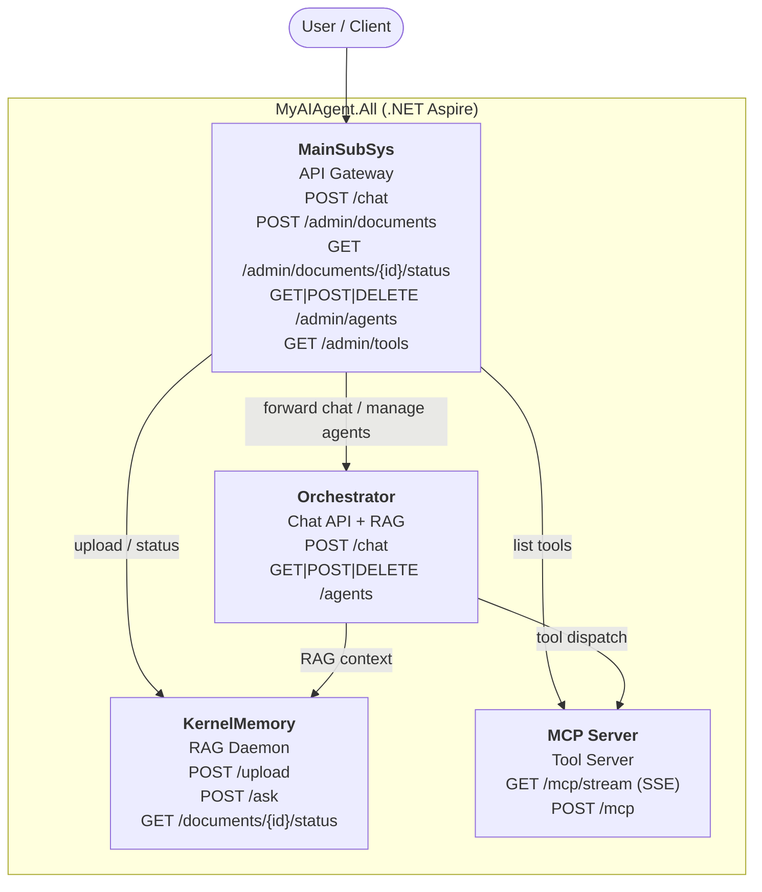
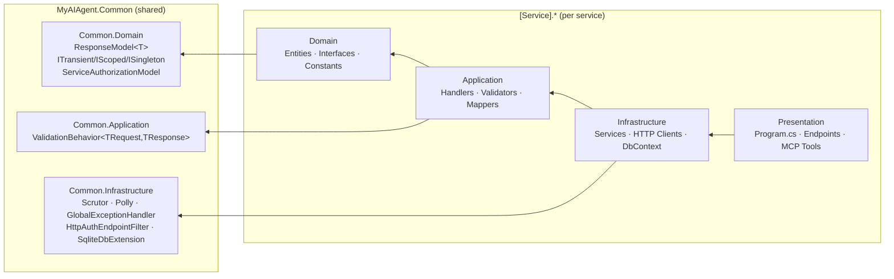

# MyAIAgent

A modular AI agent backend built on **.NET 10** with Clean Architecture. Four independently deployable services orchestrated by .NET Aspire.

## AI development workflow

Use Plan (Opus/Astra) → Build with tests (Sonnet/Sol) → parallel code/security
Verify (Sonnet/Sol) → Commit, with an optional draft PR. Start with the
[setup guide](docs/ai/setup.md); shared policy lives in [AGENTS.md](AGENTS.md) and
[the workflow](docs/ai/workflow.md).

```bash
node scripts/ai/quality.mjs
```

## Service Topology



> **Note:** MCP Server never connects to KernelMemory. RAG is the Orchestrator's responsibility.

## Clean Architecture Layers



## Services

| Service | Aspire Name | Entry Points | Purpose |
|---|---|---|---|
| **MainSubSys** | `main-subsys` | `POST /chat`, `/admin/documents`, `/admin/agents`, `/admin/tools` | API gateway — routes to all backend services |
| **Orchestrator** | `orchestrator` | `POST /chat`, `GET\|POST\|DELETE /agents` | Chat API — Microsoft Agents Framework + RAG context |
| **KernelMemory** | `kernel-memory` | `POST /upload`, `POST /ask`, `GET /documents/{id}/status` | RAG daemon — embedding, vector store, semantic Q&A |
| **MCP Server** | `mcp-server` | `GET /mcp/stream`, `POST /mcp` | Tool server — exposes tools to LLMs via Model Context Protocol |

## Tech Stack

| Area | Technology |
|---|---|
| Runtime | .NET 10 / C# 14 |
| Orchestration | .NET Aspire |
| AI Agent Framework | Microsoft Agents (`Microsoft.Agents.AI` v1.0.0-rc1) |
| AI Abstractions | `Microsoft.Extensions.AI` + `Microsoft.Extensions.AI.OpenAI` |
| RAG / Knowledge | Microsoft KernelMemory (self-hosted, Azure Cosmos DB NoSQL vector store) |
| MCP Protocol | ModelContextProtocol SDK v0.5.0-preview.1 |
| CQRS | MediatR v12.5.0 |
| Validation | FluentValidation v11.11.0 |
| HTTP Resilience | Polly via `Microsoft.Extensions.Http.Resilience` |
| DI Convention | Scrutor v7.0.0 |
| Database | Azure Cosmos DB (production) · SQLite (development) |
| Testing | xUnit + Moq + FluentAssertions |

## Solution Structure

```
src/
  MyAIAgent.slnx
  MyAIAgent.All/                          # .NET Aspire — starts all four services
  MyAIAgent.Common.Domain/                # ResponseModel<T>, DI markers, ServiceAuthorizationModel
  MyAIAgent.Common.Application/           # ValidationBehavior
  MyAIAgent.Common.Infrastructure/        # Scrutor, Polly, HttpAuthEndpointFilter, SqliteDbExtension
  MyAIAgent.McpServer.*/                  # MCP tool server (web_search, get_current_datetime)
  MyAIAgent.Orchestrator.*/               # Chat API + session persistence + agent management
  MyAIAgent.KernelMemory.*/               # Self-hosted KernelMemory RAG daemon
  MyAIAgent.MainSubSys.*/                 # API gateway (document mgmt, agent mgmt, chat forwarding)
```

## Getting Started

### Prerequisites

- .NET 10 SDK
- Azure OpenAI (or OpenAI) API credentials
- Azure Cosmos DB connection string (or use SQLite for local dev — enabled automatically)

### Run via Aspire (recommended)

```bash
dotnet restore
dotnet run --project src/MyAIAgent.All
```

Aspire starts all four services and opens the dashboard with live endpoint URLs. SQLite is used automatically in development — no Cosmos DB required locally.

### Configure secrets

```bash
# Orchestrator — AI provider
cd src/MyAIAgent.Orchestrator.Presentation
dotnet user-secrets set "AzureOpenAI:Endpoint" "https://<resource>.openai.azure.com/"
dotnet user-secrets set "AzureOpenAI:DeploymentName" "gpt-4o"
dotnet user-secrets set "AzureOpenAI:ApiKey" "<key>"

# KernelMemory — embeddings + vector store
cd src/MyAIAgent.KernelMemory.Presentation
dotnet user-secrets set "KernelMemory:Services:AzureOpenAIEmbedding:APIKey" "<key>"
dotnet user-secrets set "KernelMemory:Services:AzureOpenAIText:APIKey" "<key>"
dotnet user-secrets set "KernelMemory:Services:AzureCosmosDbNoSQL:ConnectionString" "<conn>"
```

### Build and test

```bash
dotnet build src/MyAIAgent.slnx
dotnet test src/MyAIAgent.slnx
dotnet format src/MyAIAgent.slnx --verify-no-changes
```

## Contributing

- Follow [AGENTS.md](AGENTS.md) and the [project conventions](docs/ai/project.md).
- Follow the shared [Plan → Build → Verify → Commit workflow](docs/ai/workflow.md).
- Run `node scripts/ai/quality.mjs` and both parallel reviewers before commit/PR.
- Use conventional commit prefixes: `feat:`, `fix:`, `refactor:`, `test:`, `docs:`, `chore:`
