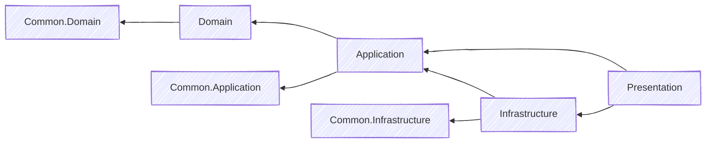
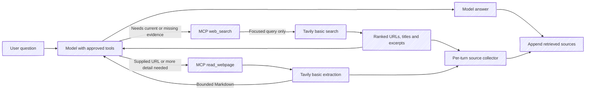
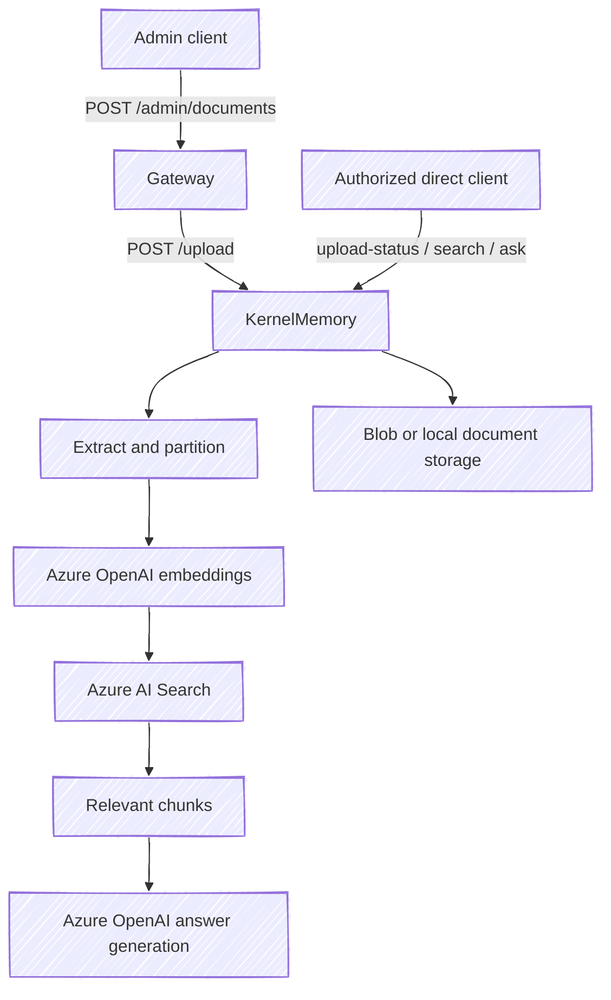

# Architecture and request flows

Follow chat and document requests through the four services. For setup, see [local development](local-development.md).

## Services and layers

| Service | Responsibility | State and external dependencies |
| --- | --- | --- |
| Gateway | Client-facing APIs, authentication, request mapping, and downstream forwarding | Orchestrator, KernelMemory upload, MCP discovery; optional JWT/JWKS settings |
| Orchestrator | Chat turns, agent selection, MCP invocation, and conversation management | Cosmos sessions/agents; Azure OpenAI or OpenAI; agent-configured MCP endpoint |
| KernelMemory | Document ingestion, vector search, and semantic question answering | Azure OpenAI, Azure AI Search, document storage; a separate Cosmos document-record model is registered |
| McpServer | Web search and webpage reading | Tavily basic search and extraction; no direct connections to source pages |

Each service follows the same layers:

| Layer | Owns |
| --- | --- |
| Domain | Entities and constants |
| Application | Contracts, handlers, validators, mappings, and dependency ports |
| Infrastructure | Provider clients and persistence |
| Presentation | Startup and HTTP endpoints |
| Tests | Unit and selected integration coverage |

Common projects hold shared types. Services communicate over HTTP.



Physical directories and solution folders use the same grouping:

```text
src/
  Aspire/MyAIAgent.All/
  Clients/MyAIAgent.ConsoleClient/
  Common/MyAIAgent.Common.{Domain,Application,Infrastructure}/
  Services/
    Gateway/MyAIAgent.Gateway.{Domain,Application,Infrastructure,Presentation,Client}/
    Orchestrator/MyAIAgent.Orchestrator.*/
    McpServer/MyAIAgent.McpServer.*/
    KernelMemory/MyAIAgent.KernelMemory.*/
  MyAIAgent.slnx
tests/
  Clients/MyAIAgent.ConsoleClient.Tests/
  Common/MyAIAgent.Common.Tests/
  Services/<Service>/MyAIAgent.<Service>.Tests/
```

`Directory.Build.props` defines shared compiler defaults; `Directory.Packages.props` pins
NuGet versions. Each project retains its own package references and specialized settings.
Common.Domain contains entity bases and lifetime markers, Common.Application owns operation
results and validation, and Common.Infrastructure owns service-key settings and external adapters.
Production projects cannot reference test projects. The root build files apply to both source and tests.

The separate processes support MCP clients and standalone KernelMemory use. Smaller Domain projects
currently hold constants; retain them while these layer boundaries are useful, and add abstractions only
for implemented responsibilities. Shared projects must not contain service-specific business logic.

## A chat turn


- **Runtime:** `Microsoft.Extensions.AI.IChatClient` with function invocation. `AgentHelper` retains the MCP client for the turn; this path does not construct an Agents Framework agent.
- **Persistence:** deltas stream immediately; completion follows the turn save. Handled title/summary save failures restore prior metadata without failing the committed turn.
- **Ownership:** chat starts a new conversation for an unknown or foreign session ID. Get/rename/delete return not found instead. Cosmos ETags reject stale updates.
- **SSE:** `session`, `delta`, `title`, `done`, `error`. Gateway emits an error when downstream ends without a terminal event. See the [public API](public-chat-api.md).

Read Gateway's `Program.cs` and chat clients, then Orchestrator's `ChatHandler`, `StreamChatHandler`, `ChatSessionHistory`, and `ChatOrchestratorService`.

### Automatic web search



Tools are model-selected and must be explicitly enabled. Empty, fully disabled, and unknown tool selections expose nothing. Orchestrator supplies current UTC time each turn and adds research guidance when either web tool is exposed. No stored agent is changed automatically.

`web_search(query, top=3)` returns a JSON array with `Url`, `Content`, `Title`, `RetrievedAtUtc`, and `Truncated`. Input: nonblank query ≤500 characters and top 1–10. Output: provider order, unique valid HTTP(S) URLs, excerpts ≤3,000 characters each and ≤20,000 combined. Retrieval time is not a source publication date. Search can be stale or wrong; excerpts remain untrusted evidence.

The typed HTTP client uses the fixed Tavily `/search` endpoint, basic/general search, no automatic tuning, generated answers, raw pages, or images. It has a 20-second deadline including the body, a 1 MiB response limit, and no retries. Successful no-results returns `[]`; configuration, credentials, quota, timeout, and malformed responses return safe MCP tool errors.

`read_webpage(url)` returns one JSON object with `Url`, `Content`, `RetrievedAtUtc`, and `Truncated`. It accepts public HTTPS URLs up to 2,048 characters, without credentials, queries, IP literals, local names, or nonstandard ports; fragments are removed. DNS must resolve only to public addresses. A separate typed client submits one URL to Tavily `/extract` with basic depth, Markdown, and no images. Its 20-second deadline covers DNS, headers, and body; responses are capped at 1 MiB and content at 8,000 characters. HTTP 200 with failed extraction is an error. Tavily fetches pages; there is no direct-fetch fallback.

`AgentHelper` wraps only first-party web tools with a per-turn collector and a shared three-invocation limit, including failures. Successful results establish up to ten validated, unique links. A completed nonempty answer receives an application-generated **Retrieved sources** footer, capped at 8,000 characters. Streaming emits it as the final text delta, so the delivered reply and persisted message match. Failure, cancellation, or empty generation produces no footer. External tools with matching names cannot populate the collector. This list identifies retrieved evidence; model-written claims and links still require scrutiny.

## Document ingestion and RAG



KernelMemory uses in-process ingestion, Azure OpenAI, and Azure AI Search. Distributed ingestion is rejected. Documents use Blob Storage in deployment or optional local storage in Development.

Gateway forwards upload only. KernelMemory exposes these authorized routes directly:

| Method | Route | Purpose |
| --- | --- | --- |
| POST | `/upload` | Multipart upload; optional `documentId` and `index` fields |
| GET | `/upload-status?documentId=...&index=...` | Poll ingestion status |
| POST | `/search` | Retrieve matching source chunks |
| POST | `/ask` | Generate an answer from retrieved sources; answer text is in `text` |
| DELETE | `/documents?documentId=...&index=...` | Remove an indexed document |

Send the configured service key in `Authorization`. Reuse the index/document ID across operations. Provider usage can incur charges.

**Not yet connected:** Orchestrator chat does not call KernelMemory. Uploads do not write through the registered Cosmos `DocumentRecord` model.

## Configuration and deployment boundaries

| Boundary | Behavior |
| --- | --- |
| Configuration | appsettings → AAC → local secrets/environment/command-line overrides |
| Azure identity | Azure CLI in Development; assigned managed identity for deployed AAC/Cosmos |
| Service URLs | Explicit `BaseUrl` settings; Aspire references supply metadata only |
| Agent tools | `AgentDefinition.McpServerEndpoint`, checked against the MCP destination policy |
| Gateway identity | Entra roles for normal routes; separate visitor JWTs for the optional public API |
| Internal calls | Shared service keys; Orchestrator trusts the user ID forwarded by Gateway |
| External MCP | Approved HTTPS origins, anonymous client, public-address checks; discovery rejection stops chat before model use |

See [local configuration](local-development.md) and [security boundaries](security.md) for credential scope, internal-network exceptions, and rotation.

## What the tests establish

Unit tests cover application behavior and failure cases; integration tests cover selected application/HTTP boundaries. Live Cosmos tests need test containers and Azure identity. Skips and healthy processes do not prove live persistence. See [contributing](../CONTRIBUTING.md) for checks.
