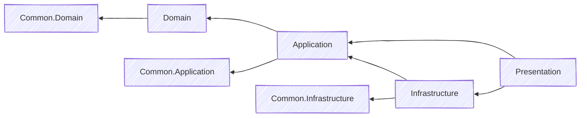
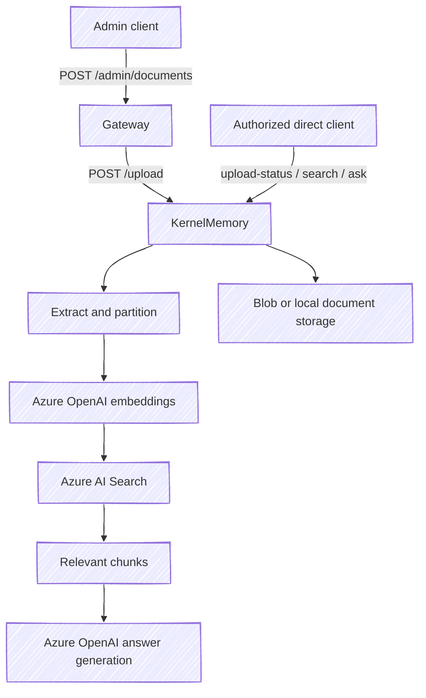

# Architecture and request flows

Follow chat and document requests through the four services. For setup, see [local development](local-development.md).

## Services and layers

| Service | Responsibility | State and external dependencies |
| --- | --- | --- |
| Gateway | Client-facing APIs, authentication, request mapping, and downstream forwarding | Orchestrator, KernelMemory upload, MCP discovery; optional JWT/JWKS settings |
| Orchestrator | Chat turns, agent selection, MCP invocation, and conversation management | Cosmos sessions/agents; Azure OpenAI or OpenAI; agent-configured MCP endpoint |
| KernelMemory | Document ingestion, vector search, and semantic question answering | Azure OpenAI, Azure AI Search, document storage; a separate Cosmos document-record model is registered |
| McpServer | Web search/page retrieval and UTC date/time tools | Google Custom Search for web search; public web pages |

Each service follows the same layers:

| Layer | Owns |
| --- | --- |
| Domain | Entities and constants |
| Application | Contracts, handlers, validators, mappings, and dependency ports |
| Infrastructure | Provider clients and persistence |
| Presentation | Startup and HTTP endpoints |
| Tests | Unit and selected integration coverage |

Common projects hold shared types. Services communicate over HTTP.

Project directories are flat under `src/`; `MyAIAgent.slnx` supplies visual groupings.

## A chat turn

- **Runtime:** `Microsoft.Extensions.AI.IChatClient` with function invocation. `AgentHelper` retains the MCP client for the turn; this path does not construct an Agents Framework agent.
- **Persistence:** deltas stream immediately; completion follows the turn save. Handled title/summary save failures restore prior metadata without failing the committed turn.
- **Ownership:** chat starts a new conversation for an unknown or foreign session ID. Get/rename/delete return not found instead. Cosmos ETags reject stale updates.
- **SSE:** `session`, `delta`, `title`, `done`, `error`. Gateway emits an error when downstream ends without a terminal event. See the [public API](public-chat-api.md).

Read Gateway's `Program.cs` and chat clients, then Orchestrator's `ChatHandler`, `StreamChatHandler`, `ChatSessionHistory`, and `ChatOrchestratorService`.

## Document ingestion and RAG

KernelMemory uses in-process ingestion, Azure OpenAI, and Azure AI Search. Distributed ingestion is rejected. Documents use Blob Storage in deployment or optional local storage in Development.

Gateway forwards upload only. KernelMemory exposes these authorized routes directly:

| Method | Route | Purpose |
| --- | --- | --- |
| POST | `/upload` | Multipart upload; optional `documentId` and `index` fields |
| GET | `/upload-status?documentId=...&index=...` | Poll ingestion status |
| POST | `/search` | Retrieve matching source chunks |
| POST | `/ask` | Generate an answer from retrieved sources; answer text is in `text` |
| DELETE | `/documents?documentId=...&index=...` | Remove an indexed document |

Send the configured service key in `Authorization`. Reuse the index/document ID across operations. Provider usage can incur charges.

**Not yet connected:** Orchestrator chat does not call KernelMemory. Uploads do not write through the registered Cosmos `DocumentRecord` model.

## Configuration and deployment boundaries

| Boundary | Behavior |
| --- | --- |
| Configuration | appsettings → AAC → local secrets/environment/command-line overrides |
| Azure identity | Azure CLI in Development; assigned managed identity for deployed AAC/Cosmos |
| Service URLs | Explicit `BaseUrl` settings; Aspire references supply metadata only |
| Agent tools | `AgentDefinition.McpServerEndpoint`, checked against the MCP destination policy |
| Gateway identity | Entra roles for normal routes; separate visitor JWTs for the optional public API |
| Internal calls | Shared service keys; Orchestrator trusts the user ID forwarded by Gateway |
| External MCP | Approved HTTPS origins, anonymous client, public-address checks; discovery rejection stops chat before model use |

See [local configuration](local-development.md) and [security boundaries](security.md) for credential scope, internal-network exceptions, and rotation.

## What the tests establish

Unit tests cover application behavior and failure cases; integration tests cover selected application/HTTP boundaries. Live Cosmos tests need test containers and Azure identity. Skips and healthy processes do not prove live persistence. See [contributing](../CONTRIBUTING.md) for checks.
