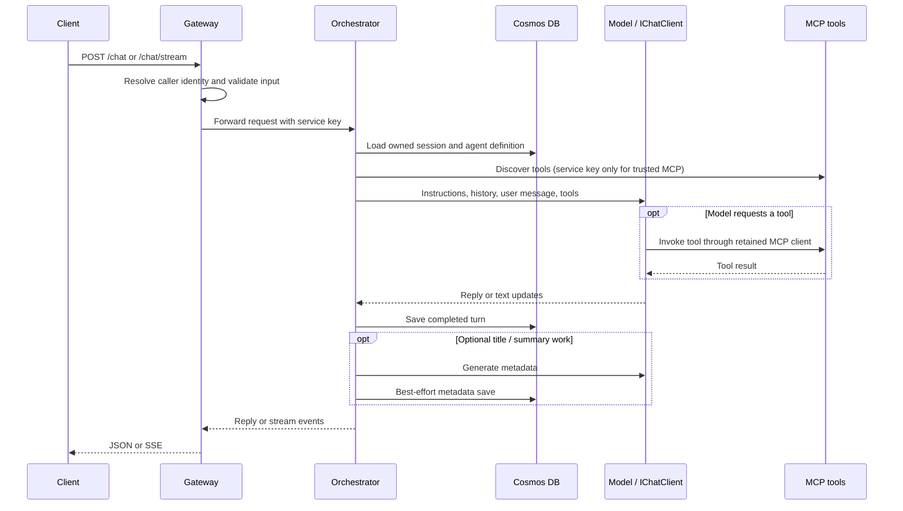
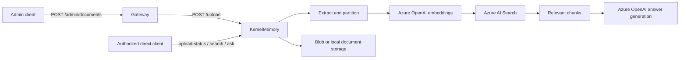

# Architecture and request flows

This guide explains the implemented service boundaries and the code to read when following a request. It separates the chat pipeline from KernelMemory's document pipeline.

## Services and layers

| Service | Responsibility | State and external dependencies |
| --- | --- | --- |
| Gateway | Client-facing APIs, authentication, request mapping, and downstream forwarding | Orchestrator, KernelMemory upload, MCP discovery; optional JWT/JWKS settings |
| Orchestrator | Chat turns, agent selection, MCP invocation, and conversation management | Cosmos sessions/agents; Azure OpenAI or OpenAI; agent-configured MCP endpoint |
| KernelMemory | Document ingestion, vector search, and semantic question answering | Azure OpenAI, Azure AI Search, document storage; a separate Cosmos document-record model is registered |
| McpServer | Web search/page retrieval and UTC date/time tools | Google Custom Search for web search; public web pages |

Each service has Domain, Application, Infrastructure, Presentation, and Tests projects. Domain holds entities/constants; Application holds contracts, handlers, validators, mappings, and dependency ports; Infrastructure implements external adapters; Presentation wires dependencies and endpoints. Common projects share cross-cutting types. Services communicate over HTTP rather than project references.

`src/MyAIAgent.slnx` groups projects visually; the actual directories are flat under `src/`.

## A chat turn

Read Gateway `Program.cs`, its chat handlers/clients, then Orchestrator's `ChatHandler`, `StreamChatHandler`, `ChatSessionHistory`, and `ChatOrchestratorService`. Streaming deltas are forwarded as they arrive; successful completion follows turn persistence. Optional metadata saves are separate from committing the turn. Their handled persistence failures restore the previous in-memory metadata and preserve the successful reply.

`IChatClient` is wrapped with function invocation. `AgentHelper` discovers tools from the agent's stored MCP URL and keeps the transport alive for the turn. Installed Microsoft Agents packages do not mean the current path constructs an Agents Framework agent; the runtime path here uses `Microsoft.Extensions.AI` directly.

An unknown or foreign session ID starts a new conversation on chat. Conversation get/rename/delete operations instead report not found when ownership does not match. Cosmos ETags protect session updates against concurrent overwrites.

The SSE contract uses `session`, `delta`, `title`, `done`, and `error`. Gateway synthesizes an error if the downstream stream ends without a terminal event. See the [public API guide](public-chat-api.md) for browser handling.

## Document ingestion and RAG

The service wires KernelMemory's in-process orchestration and default ingestion handlers. Distributed orchestration is rejected by the provider configuration. Azure AI Search is the supported memory database. Local storage is possible in Development; deployed services require Azure Blob document storage.

The pinned KernelMemory API exposes these routes directly (the Gateway currently forwards upload only):

| Method | Route | Purpose |
| --- | --- | --- |
| POST | `/upload` | Multipart upload; optional `documentId` and `index` fields |
| GET | `/upload-status?documentId=...&index=...` | Poll ingestion status |
| POST | `/search` | Retrieve matching source chunks |
| POST | `/ask` | Generate an answer from retrieved sources; answer text is in `text` |
| DELETE | `/documents?documentId=...&index=...` | Remove an indexed document |

Use the configured `Authorization` service key for these routes. Keep the same index/document ID across upload, polling, querying, and deletion. These APIs can consume paid provider resources.

Orchestrator currently has no retrieval client or call into this pipeline. Likewise, the Cosmos `DocumentRecord` entity/context is present but the current upload forwarding path does not write a record through it. Do not infer either integration from the project references or registered models.

## Configuration and deployment boundaries

AAC is inserted after appsettings files and before local overrides. Development uses Azure CLI identity and per-project user-secrets; deployed AAC/Cosmos connections require a configured user-assigned managed identity. Provider keys and shared service keys still exist where the adapters require them.

Aspire `.WithReference(...)` supplies service metadata, but the current typed clients read explicit `BaseUrl` settings. Agent tool discovery reads `AgentDefinition.McpServerEndpoint`. The [local guide](local-development.md) therefore sets addresses matching the service launch profiles.

Outside Development, Gateway uses Entra role policies for its normal chat/admin surfaces. The optional public API validates a different visitor JWT and derives its own owner identity. Orchestrator trusts caller-supplied user IDs behind a shared service key. MCP requires its service key by default, and both callers attach it only to its configured trusted origin and protocol paths. External MCP endpoints use a separate anonymous client and require an administrator-configured HTTPS origin allowlist. Shared connection checks reject prohibited DNS addresses before opening sockets; only the configured first-party MCP service has the narrow internal-network/Development loopback exception. Authentication or destination-policy rejection during discovery stops the chat before model invocation instead of silently dropping tools. Credential scope, outbound policy, rotation, and provider-key boundaries are detailed in [security](security.md).

## What the tests establish

Unit tests cover handlers, validation, mapping, HTTP behavior, configuration guards, and failure cases. Integration tests exercise selected application/HTTP boundaries. Cosmos repository tests require separately provisioned test containers and Azure identity; skips do not establish live persistence behavior. Health checks alone establish process availability. See [contributing](../CONTRIBUTING.md) for commands and evidence requirements.
